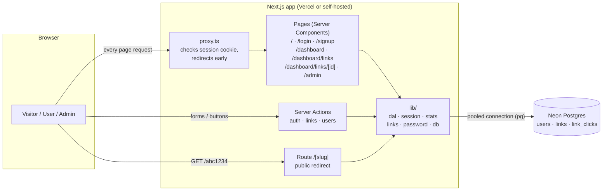
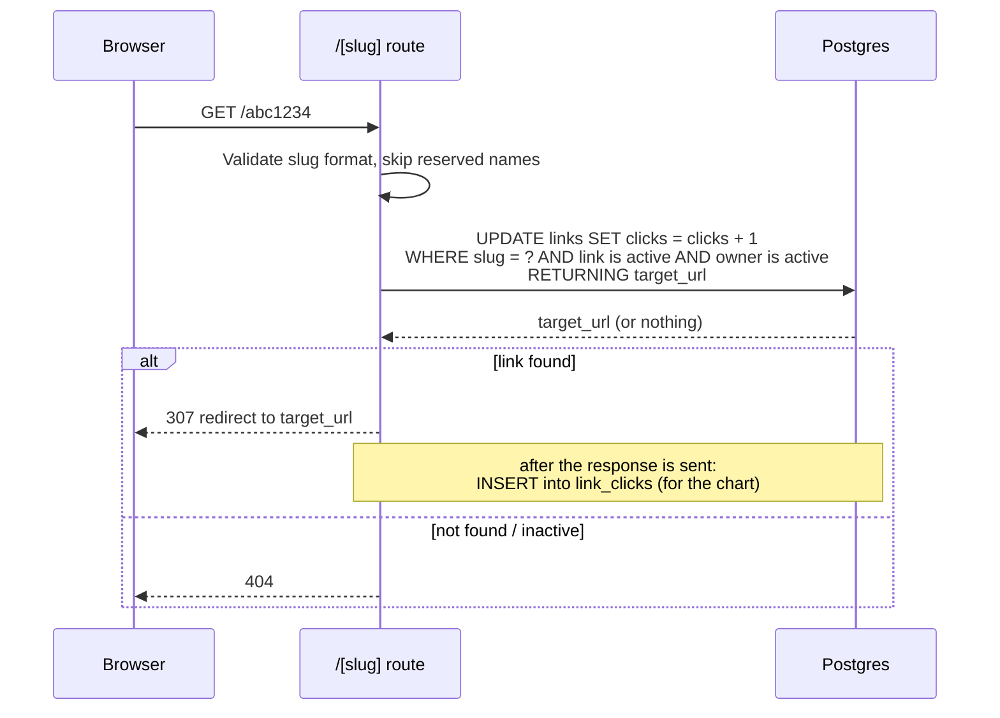
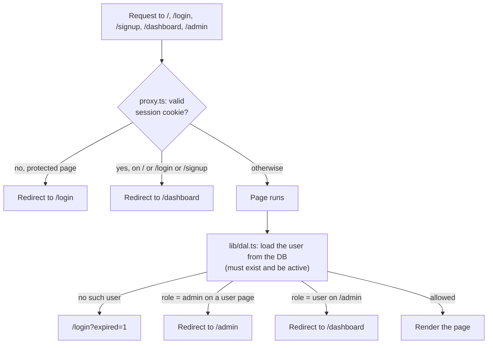
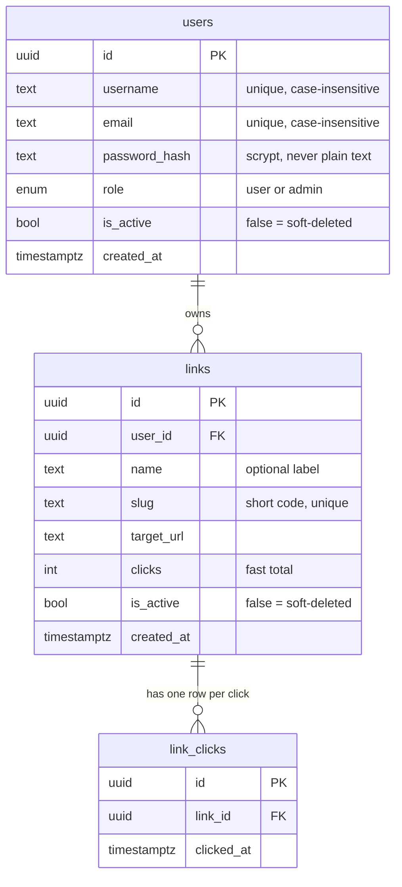

# Shrink

A URL shortener. Users sign up, turn long URLs into short links, and see how many times each link is clicked. Admins can see every user and every link.

**Stack:** Next.js 16 (App Router, Server Components, Server Actions, Cache Components) · React 19 · Tailwind CSS 4 · Drizzle ORM · Neon Postgres · `jose` (JWT session cookie) · TypeScript

> Read this first: Next.js 16 differs from older versions. Before changing framework-level code, check `node_modules/next/dist/docs/` (see `AGENTS.md`).

---

## 1. What the app does

| Who | Can do |
|---|---|
| Visitor (signed out) | See the landing page, sign up, log in, and open any short link (`/{slug}`) |
| User | Create links (random code or custom alias), give them a name, edit, copy, delete, search/filter/sort, see click stats and a 14/30-day chart |
| Admin | See all users and all links, delete any link, deactivate users |
| Signed-in person | Cannot open `/`, `/login` or `/signup`; they are sent to their dashboard |

Admins are never created through sign-up. Every new account is a normal user; promote someone by changing `role` in the database.

---

## 2. High-level design (diagram)

### 2.1 System overview

### 2.2 What happens when someone opens a short link

### 2.3 Login and access control

The proxy only does a cheap check of the cookie's signature and expiry (no database). The real authorization, including the user's current role and active flag, happens in `lib/dal.ts` on every request.

### 2.4 Database

---

## 3. How it works (tables)

### 3.1 Routes

| URL | Type | Who | What it does |
|---|---|---|---|
| `/` | Static page | Signed-out only | Landing page |
| `/login`, `/signup` | Static pages | Signed-out only | Auth forms |
| `/dashboard` | Dynamic page | User | Overview: totals, 14-day chart, top links |
| `/dashboard/links` | Dynamic page | User | Links table with search, filter, sort, paging, create/edit/delete |
| `/dashboard/links/[id]` | Dynamic page | User (owner) | One link: stats, 30-day chart, recent clicks |
| `/admin` | Dynamic page | Admin | All users and all links |
| `/[slug]` | Route handler | Anyone | The public redirect |
| `/api/health/db` | Route handler | Anyone | Returns `{"status":"ok"}` if the DB is reachable (reveals nothing else) |

### 3.2 Server Actions (all writes)

| File | Action | What it does |
|---|---|---|
| `app/actions/auth.ts` | `signup` | Validates input, hashes the password, creates a user (always role `user`), signs in |
| | `login` | Checks email and password (same timing whether or not the email exists); rejects inactive users |
| | `logout` | Deletes the session cookie |
| `app/actions/links.ts` | `createLink` | Validates the URL, name and alias; inserts; retries on a random-code collision |
| | `updateLink` | Edits name, destination and alias (owner or admin) |
| | `deleteLink` | Soft delete: sets `is_active = false` |
| `app/actions/users.ts` | `deactivateUser` | Admin only; soft-deletes a user (never yourself) |

### 3.3 Code map

| Path | Purpose |
|---|---|
| `proxy.ts` | Early redirects based on the session cookie |
| `lib/session.ts` | Signs and reads the session JWT cookie (7 days, `httpOnly`, `sameSite=lax`) |
| `lib/dal.ts` | Data access layer: `getCurrentUser`, `requireUser`, `requireAdmin`, `requireUserWith` |
| `lib/db.ts` | Postgres pool (kept warm) + Drizzle client |
| `lib/stats.ts` | Overview, link detail and link search queries |
| `lib/links.ts` | Slug rules, reserved names, URL normalization |
| `lib/password.ts` | scrypt hashing and verification |
| `lib/origin.ts` | Works out the public host/protocol for building short URLs |
| `db/schema.ts` | Table definitions (source of truth) |
| `db/migrations/` | SQL migrations generated by Drizzle |
| `app/components/` | UI: shells, tables, modals (details, edit, new link, confirm), forms, chart |
| `scripts/seed-dummy.mjs` | Optional: creates demo users, links and click history |

### 3.4 Key behaviours

| Topic | How it works |
|---|---|
| Sessions | A signed JWT in an `httpOnly` cookie that only holds the user id. The role is always read fresh from the DB, so promoting or deactivating someone applies immediately |
| Passwords | scrypt with a random salt; never stored in plain text |
| Soft delete | "Delete" sets `is_active = false` on a link or user. Rows are never removed. Inactive items disappear everywhere, inactive users cannot log in, and an inactive link (or one owned by an inactive user) returns 404 |
| Slugs | 3–30 chars (`a-z A-Z 0-9 - _`), unique across the whole app, never equal to a route name (`login`, `admin`, `api`, ...). A soft-deleted link keeps its slug reserved |
| Click counting | `links.clicks` is a fast running total; `link_clicks` has one row per click for the charts. The per-click row is written after the redirect is sent so it adds no delay |
| Confirmations | Delete asks "Are you sure…?" first. Edit opens a modal and asks for confirmation only when you press Save |

---

## 4. Performance: what we found and changed

The app felt slow. We measured instead of guessing.

| Finding | Evidence | Fix |
|---|---|---|
| The database is far away (Neon, us-east-2). Every query costs about **210 ms** round trip | `select 1` takes ~210 ms | Fewer round trips per page (below) |
| A new DB connection takes about **1.6 s**, and the pool closed idle connections after 10 s | First query 1.6 s, later ones 0.2 s | Pool keeps connections for 5 min, uses TCP keep-alive, and opens 3 at startup |
| Pages ran their queries one after another (2–4 round trips) | Dashboard took 600 ms – 1 s | Queries now run together: **1 round trip per page**. The links page does search, count and totals in one query. The page data loads at the same time as the login check (`requireUserWith`) |
| Redirects waited for the click to be written | 2 round trips per redirect | The click row is written in `after()`, so the redirect takes 1 round trip |
| Every navigation went back to the server | Router cache was 0 s for dynamic pages | `staleTimes.dynamic = 30` in `next.config.ts`: revisiting a page within 30 s is instant. Any create/edit/delete clears this cache, so changes still show immediately |
| `next build` was **failing** on `/admin` | "unstable value `Date.now()` while prerendering" | `/admin` and the health route now opt out of prerendering with `await connection()` |
| `/api/health/db` was public and returned the DB name and Postgres version | Read the route | Now returns only `{"status":"ok"}` |

Timings on a production build (`next build && next start`), warm. "After" was measured; "before" is the earlier measurement for the dev server and an estimate from the number of round trips:

| Page | Before | After |
|---|---|---|
| `/dashboard`, `/dashboard/links`, link detail, `/admin` | ~0.6 – 1 s | **~0.25 s** (one DB round trip) |
| `/[slug]` redirect | ~0.45 s | **~0.22 s** |
| `/`, `/login` | ~0.02 s | ~0.005 s |
| Visiting a page again within 30 s | ~0.25 s | **instant** (browser cache) |

Two important notes:

- **`npm run dev` is always slower** than production: each route compiles the first time you open it (about 1.7 s). Judge speed with `npm run build && npm start`.
- The remaining ~0.2 s per page is the distance to the database. **To go lower, create the Neon project in the region closest to where you run the app** (and deploy the app in the same region).

---

## 5. Run it

### Environment variables (`.env.local`)

| Name | What for |
|---|---|
| `DATABASE_URL` | Neon **pooled** connection string (used by the app) |
| `DATABASE_URL_UNPOOLED` | Neon **direct** connection string (used by migrations) |
| `SESSION_SECRET` | Long random string that signs the session cookie |
| `DEV_ORIGINS` | Optional, dev only: comma-separated hosts (e.g. your phone on the LAN) |

### Commands

| Command | What it does |
|---|---|
| `npm install` | Install dependencies |
| `npm run dev` | Dev server on http://localhost:3000 (restart it after changing `next.config.ts`) |
| `npm run build` then `npm start` | Production build and server (use this to judge speed) |
| `npm run lint` | ESLint |
| `npm run db:generate` | Create a SQL migration after editing `db/schema.ts` |
| `npm run db:migrate` | Apply pending migrations |
| `npm run db:studio` | Browse the data |
| `node --env-file=.env.local scripts/seed-dummy.mjs` | Create demo data (`--remove` deletes it) |

### Changing the database

1. Edit `db/schema.ts`.
2. `npm run db:generate` (creates a new file in `db/migrations/`).
3. `npm run db:migrate`.

Never edit or regenerate an existing migration file: Drizzle records a hash of each one in `drizzle.__drizzle_migrations`.

---

## 6. Known limits and ideas

| Item | Note |
|---|---|
| No UI to reactivate a soft-deleted link or user | Set `is_active = true` in the database |
| A deleted link keeps its slug, a deactivated user keeps their email and username | They stay reserved; making the unique indexes apply to active rows only would free them |
| Changing a link's alias breaks URLs already shared with the old one | By design |
| Click counts on a page may be up to 30 s old when you come back to it | Browser router cache (see section 4) |
| Admin cannot edit links, and admin user deletion has no confirmation yet | Easy follow-ups |
